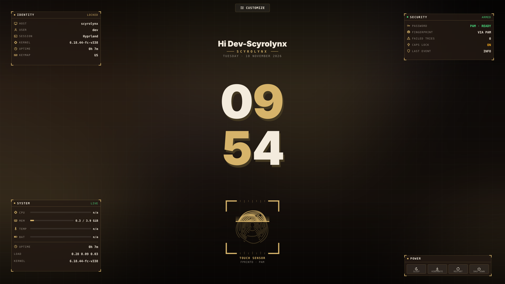
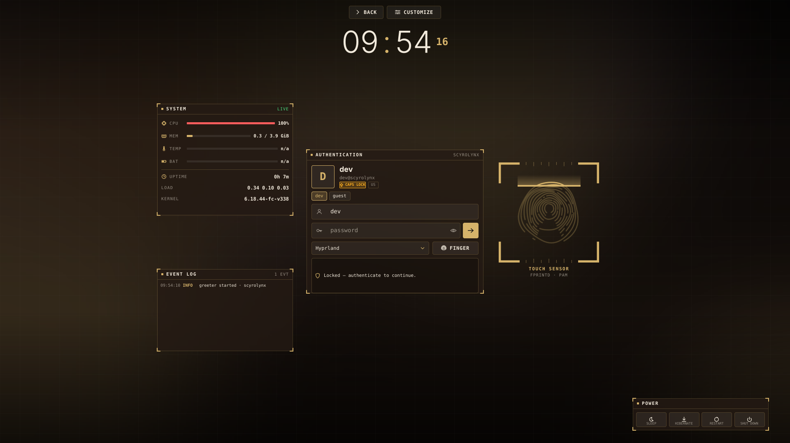

# scyrolynx-serpantinum - SDDM theme (Qt6 / SDDM 0.21)

Two states: **lock screen** (clock, fingerprint scanner, identity / security / system blocks) -> click or just start typing -> **login dashboard** (login form, scanner, system, event log). Esc goes back.

 

## What is real now
- **Login form**: editable user name, password with show/hide, Caps-Lock warning, keymap badge, user switcher (when >1 account), session picker, fingerprint button. Typing on the lock screen opens the form *and keeps the first character*.
- **Every block is movable + resizable**: top "Customize" -> drag a block, pull its corner grip, eye = hide/restore, snap-to-grid, interface scale. Layout is stored per screen.
- **Wallpaper by folder path**: Customize -> Wallpaper -> type an absolute folder, press SCAN, click a thumbnail. Optional slideshow (1/5/15 min) with cross-fade, shuffle, blur, darkness. Default folder via `wallpaper_dir` in theme.conf.
- **Live cards**: CPU, RAM, temperature, battery, load, uptime, kernel (see docs/AUTHENTICATION.md for the one env var), real event log of auth attempts, free-text scratchpad, real power actions (sleep / hibernate / restart / shut down, two-step confirm).
- **Fingerprint scanner rebuilt**: procedural ridge pattern revealed by a scan line, HUD / Ring / Minimal styles, honest states (accepted only after `loginSucceeded`).
- Accents: Arc Gold, Citrine, Cobalt, Phosphor, Violet, Crimson, Bronze, Ivory. Clock: Checker / Inline / HUD.

Saved to `/var/lib/sddm/.config/scyrolynx-serpantinum.conf`. Static options: theme.conf. See docs/.

## Test status
Verified (PySide6 6.12, offscreen software renderer, mocked SDDM, `tools/preview.py`): loads with 0 QML warnings at 1920x1080; typing on the lock screen opens the form and `sddm.login` receives user/password/session index; drag and resize of blocks work and persist to the settings file; wallpaper folder scan lists images; telemetry reads /proc.
NOT verified: real SDDM greeter, real PAM/fprintd, MultiEffect blur (software renderer can't draw it), writing the settings file as user `sddm`, multi-monitor, power actions, FolderListModel on your real wallpaper folder, SDDM's `keyboard` object shape (guarded, falls back to "-"). Check versions: `pacman -Q sddm qt6-base qt6-declarative`.
